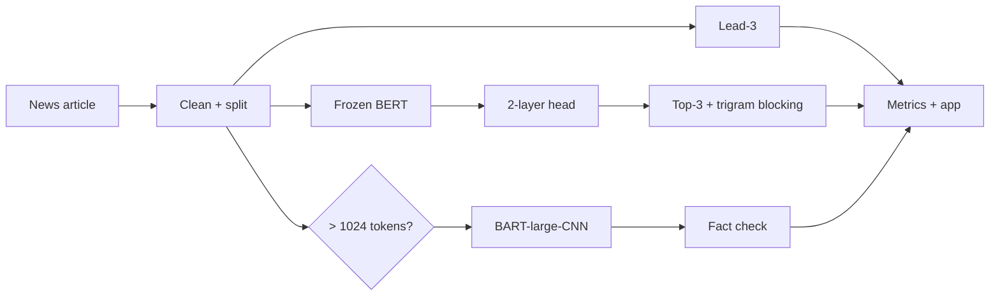
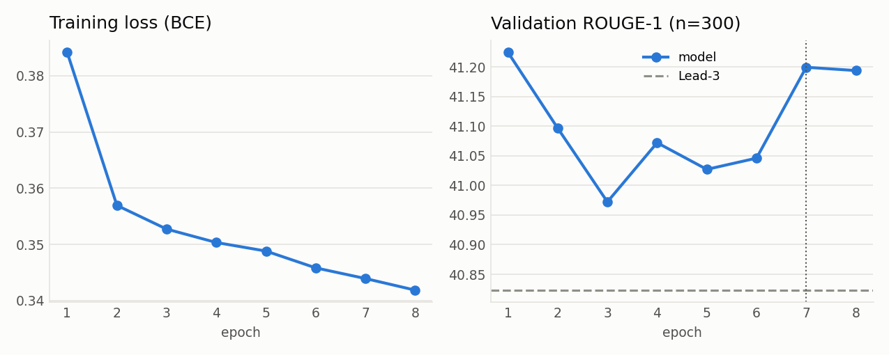
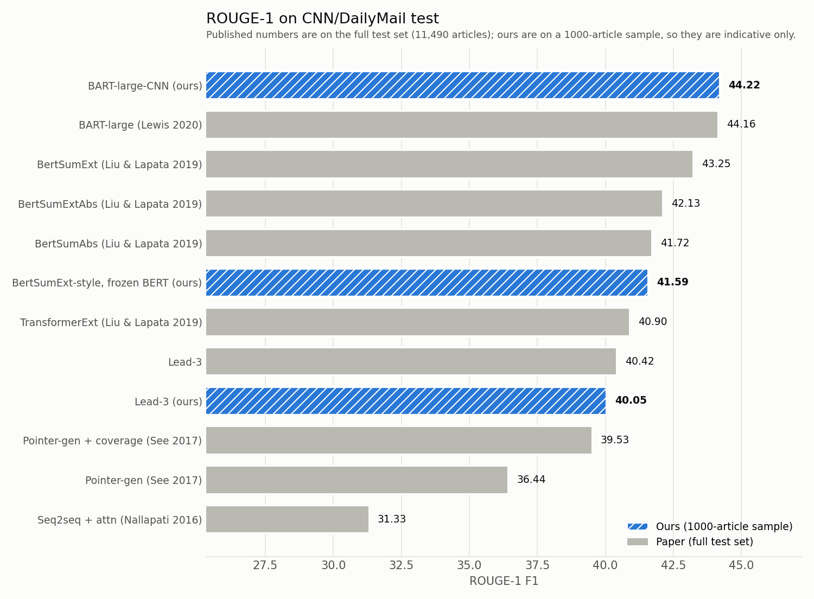
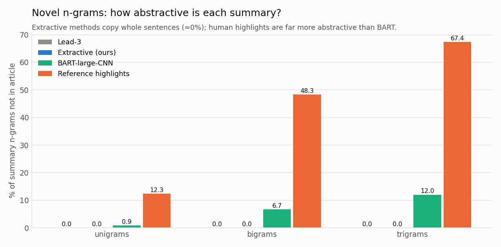
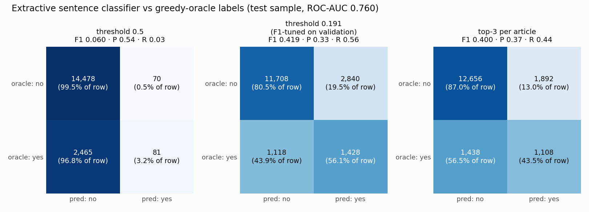
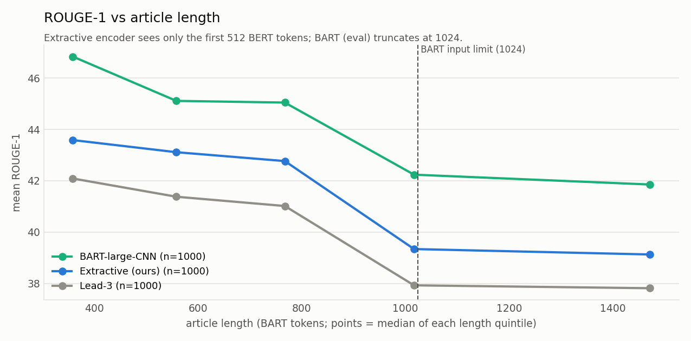
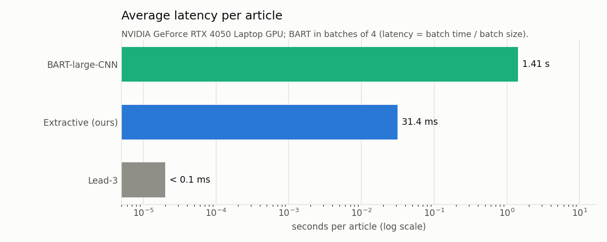
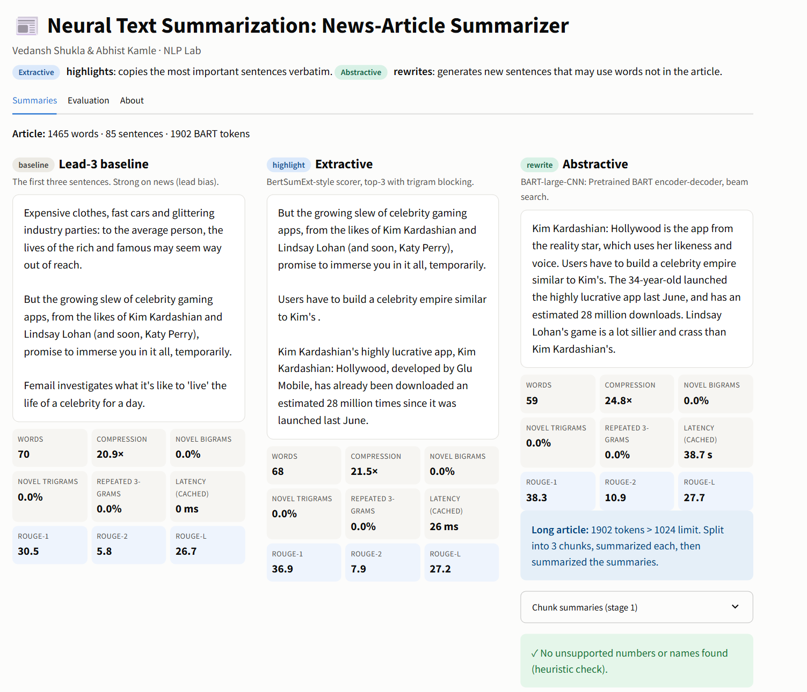
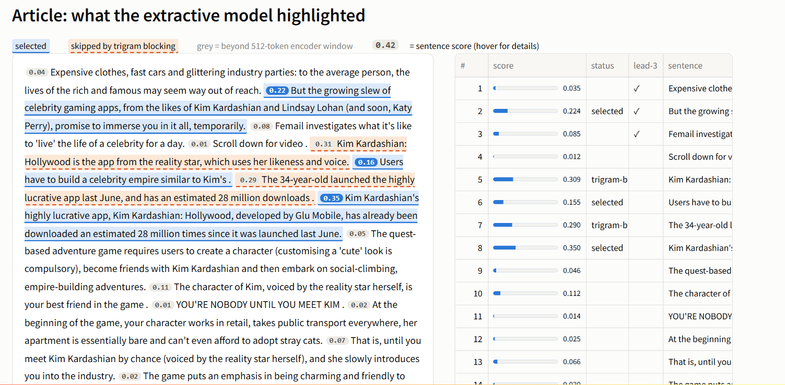

<!-- title-start -->
# Neural Text Summarization: A News-Article Summarizer Prototype

- **Authors:** Vedansh Shukla & Abhist Kamle
- **Course:** NLP Lab: Project Report
- **Date:** November 2026
- **Code:** github.com/Abhist17/news-summarizer-nlp
<!-- title-end -->

## Abstract

We build and compare three news-article summarizers on the CNN/DailyMail benchmark: the Lead-3 baseline, a lightweight BertSumExt-style extractive model that scores sentences with a two-layer Transformer over frozen BERT sentence vectors, and the pretrained abstractive model BART-large-CNN. The extractive head (1.97 M parameters) is trained on greedy-oracle labels from 3,000 articles in 1.3 minutes on a laptop GPU.

On 1,000 test articles, BART-large-CNN achieves the best ROUGE-1/2/L (44.22 / 21.31 / 41.07), followed by our extractive model (41.59 / 18.77 / 37.91) and Lead-3 (40.05 / 17.42 / 36.33); paired bootstrap tests show that both gaps are statistically significant. Our Lead-3 and BART results are within 0.4 ROUGE-1 of the published 40.42 and 44.16, while freezing BERT costs our extractive model 1.7 points against the published BertSumExt (43.25). A novel n-gram analysis shows that BART is far less abstractive than the human highlights (6.7% versus 48.3% novel bigrams).

We also address two gaps of the reference papers. Articles longer than BART's 1,024-token input are summarized chunk by chunk, and a named-entity check flags names and numbers in abstractive summaries that do not occur in the article. The check flags 3.1% of BART summaries, and manual inspection confirms that 27 of the 31 flags point to content the article does not support. An interactive Streamlit demo shows the three summaries side by side and explains every decision of the extractive model.

<!-- pagebreak -->

## 1. Introduction

News is published faster than anyone can read it, and a reader often needs only the few facts that matter. Automatic text summarization addresses this by producing a short text that keeps the most important content of a longer document. There are two families of methods. **Extractive** summarizers select whole sentences from the article and copy them verbatim, so their output is always grammatical and faithful to the source but cannot compress or paraphrase. **Abstractive** summarizers generate new text, like a human editor, so they can fuse and shorten information, but they can also produce statements the article never made.

This project builds and compares both families on the standard CNN/DailyMail news benchmark, against the strong Lead-3 baseline. Our objectives were:

1. Implement a Lead-3 baseline, a BertSumExt-style extractive model (Liu & Lapata, 2019) that we train ourselves, and a pretrained transformer abstractive model (BART-large-CNN).
2. Evaluate all three with ROUGE-1/2/L and with diagnostic metrics (novel n-grams for abstractiveness, repeated n-grams for redundancy), report confidence intervals, and compare with published results.
3. Address two gaps of the reference papers in a lightweight way: **long documents** that exceed the model input length, and **factual consistency** of abstractive output.
4. Deliver an interactive demo that shows the three summaries side by side and explains why the extractive model chose each sentence.

## 2. Background and Related Work

**Lead-3.** News articles follow an "inverted pyramid": the key facts come first. Taking the first three sentences is therefore a very strong baseline on CNN/DailyMail (40.42 ROUGE-1), and many neural systems struggled to beat it.

**Sequence-to-sequence with attention** (Nallapati et al., 2016) was the first neural abstractive model on this dataset (31.33 ROUGE-1). It often reproduced factual details wrongly, could not handle out-of-vocabulary words, and repeated itself.

**Pointer-generator networks** (See et al., 2017) add a copy mechanism that lets the decoder point to source words, which fixes out-of-vocabulary names and numbers, and a **coverage** loss that penalises attending to the same source positions repeatedly, which reduces repetition (39.53 ROUGE-1). See et al. also introduced the analysis of novel n-grams that we reuse to measure how abstractive a summary really is.

**BertSum** (Liu & Lapata, 2019) uses pretrained BERT as a document encoder. Each sentence gets its own [CLS] token and alternating segment embeddings; the [CLS] vectors are passed to inter-sentence Transformer layers that score every sentence (**BertSumExt**, 43.25 ROUGE-1). The abstractive variants (BertSumAbs, BertSumExtAbs) fine-tune an encoder-decoder. Training labels for the extractive model come from a greedy oracle that picks the sentences maximising ROUGE against the reference, and trigram blocking removes redundant sentences at inference.

**BART** (Lewis et al., 2020) is a denoising sequence-to-sequence transformer pretrained by corrupting and reconstructing text. The `facebook/bart-large-cnn` checkpoint is BART-large fine-tuned on CNN/DailyMail and is a standard strong abstractive summarizer.

**Gaps.** Both reference papers truncate the input (400 tokens for See et al., 512 for BertSum), so content later in long articles is never seen. Neither evaluates factual consistency: ROUGE rewards word overlap, not correctness, so a fluent summary with a wrong name or number can still score well. Our project adds simple, transparent mechanisms for both.

## 3. Dataset

We use **CNN/DailyMail 3.0.0** (`abisee/cnn_dailymail` on the Hugging Face Hub), the non-anonymised version used by See et al. and Liu & Lapata. Each example is a news article paired with human-written bullet-point "highlights" that serve as the reference summary.

*Table 1. CNN/DailyMail 3.0.0 splits and the subsets used in this project.*

| Split | Articles | Used in this project |
|---|---|---|
| train | 287,113 | 3,000 (training the extractive head) |
| validation | 13,368 | 300 (model selection, classifier threshold) |
| test | 11,490 | 1,000 (evaluation of all methods) |

**Sampling.** The dataset files list all CNN stories before the Daily Mail ones, so taking the first *n* rows would give a CNN-only sample. For training we take an equal number of rows from the start of each of the three train shards (one CNN, two Daily Mail), which matches the roughly 1:2 CNN:DM ratio of the full split. For validation and test we take every *k*-th article over the whole split (*k* = split size / *n*), a deterministic, evenly spread sample. Subsets are streamed (we never download the full 1.3 GB dataset) and cached locally so every later run is offline and identical.

**Preprocessing.** We normalise whitespace and strip the Daily Mail byline and timestamp header ("By . Name . PUBLISHED: . 10:01 EST, 3 May 2013 ..."), which otherwise appears as junk "sentences" in Lead-3. Sentences are split with NLTK Punkt; fragments with fewer than three word tokens are dropped.

**XSum** (Narayan et al., 2018), BBC articles with single-sentence, highly abstractive summaries, is used only as an out-of-domain stress test.

## 4. System Design

The system runs three summarizers on the same cleaned and sentence-split article and scores their outputs with the same metrics. Figure 1 shows the full pipeline.

*Figure 1. System pipeline. Blue: extractive model; green: abstractive model; orange: factual check.*

### 4.1 Lead-3 baseline

The first three sentences of the cleaned article. Lead-3 is cheap and surprisingly hard to beat on news because of the inverted-pyramid writing style.

### 4.2 Extractive model (BertSumExt-style)

**Labels.** For every training article a greedy oracle adds, one at a time, the sentence that most increases ROUGE-1 F1 + ROUGE-2 F1 of the selected set against the reference highlights, stopping after three sentences or when nothing improves (the BertSum procedure). Selected sentences are labelled 1, all others 0; about 15% of the sentences inside the encoder window are positive, so the classes are imbalanced.

**Document encoder.** As in BertSum, the article is encoded as `[CLS] s1 [SEP] [CLS] s2 [SEP] ...` with alternating segment ids (0, 1, 0, 1, ...) and truncated to 512 word pieces (any single sentence is capped at 200 pieces so it cannot fill the window). We use `bert-base-uncased`. Each sentence is represented by its [CLS] vector concatenated with the mean of its word-piece vectors (1,536 dimensions); the mean-pooled half gives the frozen encoder a direct view of the sentence content.

**Scoring head.** A linear projection to 256 dimensions plus sinusoidal sentence-position encodings, two pre-norm Transformer encoder layers (4 heads, feed-forward 1,024, dropout 0.3), layer normalisation, and a linear layer with a sigmoid that outputs the probability that each sentence belongs in the summary.

**Main deviation from the paper.** BertSumExt fine-tunes all of BERT for 50,000 steps on 287k articles with multiple GPUs. To fit a student budget we **freeze BERT**, compute the sentence vectors once, cache them, and train only the head (1.97 M parameters, versus 110 M in BERT-base) on 3,000 articles. Training then takes 1.3 minutes on a laptop GPU and the trained head is a 4 MB file that we ship with the code. The cost is some accuracy, which we quantify in Section 6.

**Training.** Masked binary cross-entropy over real (non-padding) sentences, AdamW (learning rate 1e-3, weight decay 0.01), batch size 32, 8 epochs, 10% linear warm-up then linear decay, gradient clipping at 1.0, seed 42. After each epoch we summarize the 300 validation articles and keep the checkpoint with the best mean of ROUGE-1/2/L.

**Inference.** Rank sentences by probability, take the top three, skip any candidate that shares a trigram with an already selected sentence (trigram blocking), and output the chosen sentences in article order. Sentences beyond the 512-token window receive no score and cannot be selected. If no trained checkpoint is available the app falls back to an unsupervised TF-IDF TextRank scorer and labels this clearly, so the demo never crashes.

### 4.3 Abstractive model (BART-large-CNN)

We use the pretrained `facebook/bart-large-cnn` checkpoint (406 M parameters) instead of training a pointer-generator ourselves, which would take days of GPU time and still score below BART. Decoding uses the settings from the model card: beam search with 4 beams, no repeated trigrams, length penalty 2.0, and 56 to 142 output tokens. The demo also offers DistilBART-CNN-12-6 (`sshleifer/distilbart-cnn-12-6`, 306 M parameters) as a faster option.

### 4.4 Long-document handling

BART reads at most 1,024 tokens. In the demo, longer articles are split on sentence boundaries into chunks of about 900 tokens. Each chunk is summarized with shorter settings (30 to 90 tokens), the chunk summaries are concatenated, and that text is summarized again ("summarize-then-summarize"; repeated if it is still too long). For the ROUGE evaluation we follow the standard protocol and truncate at 1,024 tokens, so that our numbers are comparable to published ones; Section 6.6 analyses what this truncation costs.

### 4.5 Factual-consistency check

A transparent heuristic flags "new facts" in the abstractive summary: named entities (spaCy `en_core_web_sm`: people, organisations, places, events, ...) whose content words do not occur in the article, and numbers, dates and amounts that cannot be found in the article (with number words such as "three" matched to "3"). Flagged spans are highlighted in the demo. This is deliberately simple: it catches invented names and numbers, but it cannot detect wrong relations between correct entities, and it can flag legitimate rewrites.

### 4.6 Evaluation metrics

- **ROUGE-1, ROUGE-2, ROUGE-L** F1 × 100 against the reference highlights (Google `rouge-score` 0.1.2 with Porter stemming; ROUGE-L is the summary-level `rougeLsum`, as reported in the papers). We report the mean over articles with a 95% percentile-bootstrap confidence interval (2,000 resamples).
- **Novel n-grams**: percentage of summary n-grams (n = 1, 2, 3, within sentences) that do not appear in the article. Extractive summaries score about 0%; higher means more abstractive (See et al., 2017).
- **Repeated n-grams**: percentage of summary n-grams that repeat an earlier n-gram of the same summary (redundancy).
- **Compression**: article words divided by summary words; **latency**: seconds per article.
- **Sentence-classifier metrics** for the extractive model against the oracle labels: accuracy, precision, recall, F1 and ROC-AUC, with confusion matrices.

## 5. Experimental Setup

All systems are evaluated on the same 1,000 CNN/DailyMail test articles (every 11th article of the test split). The decision threshold of the sentence classifier is tuned on the 300 validation articles, and 100 XSum test articles form the out-of-domain stress test. Table 2 lists the remaining settings.

*Table 2. Hardware, software and hyperparameters.*

| Setting | Value |
|---|---|
| Hardware | NVIDIA GeForce RTX 4050 Laptop GPU (6 GB), Intel Core i7-14700HX (28 threads), Windows 11 |
| Software | Python 3.12, PyTorch 2.5.1 (CUDA 12.4), Hugging Face Transformers 4.46.3, rouge-score 0.1.2, spaCy 3.8 |
| Extractive encoder | `bert-base-uncased`, frozen; 512 word pieces; [CLS] + mean pooling (1,536-d) |
| Extractive head | 2 Transformer layers, d = 256, 4 heads, FF 1,024, dropout 0.3; 1.97 M parameters |
| Head training | 3,000 train articles, 8 epochs, AdamW lr 1e-3, batch 32, warm-up 10%, best epoch by validation ROUGE |
| Extractive inference | top-3 sentences, trigram blocking, article order |
| Abstractive model | `facebook/bart-large-cnn`, 406 M parameters, beam 4, no-repeat trigram, length penalty 2.0, 56 to 142 tokens |
| Abstractive input | truncated at 1,024 tokens for evaluation; chunked in the demo |
| ROUGE | rouge-score with Porter stemmer, F1 × 100, ROUGE-L = rougeLsum, 95% bootstrap CI |

All three systems are evaluated on the same test articles, and every number in Section 6 is produced by one command (`run.ps1 eval-full`, see Appendix A), which writes the tables, the per-article outputs and the figures.

## 6. Results

### 6.1 Training the extractive model

The training loss falls steadily over the 8 epochs (0.384 to 0.342), while validation ROUGE-1 stays in a narrow band between 40.97 and 41.22, always above Lead-3 on the same articles (40.82). With a frozen encoder the head learns the useful signal within the first epoch; later epochs fit the training labels better without improving the selected summaries much. The best epoch (7) reaches 41.20 / 18.27 / 37.65 ROUGE-1/2/L on validation, against 54.73 ROUGE-1 for the oracle labels it was trained to imitate.

### 6.2 Main results on CNN/DailyMail

*Table 3. ROUGE F1 on 1,000 CNN/DailyMail test articles (mean with 95% bootstrap confidence interval) and average summary length in words.*

| Method | Articles | ROUGE-1 [95% CI] | ROUGE-2 [95% CI] | ROUGE-L [95% CI] | Words |
|---|---|---|---|---|---|
| Lead-3 | 1,000 | 40.05 [39.32, 40.79] | 17.42 [16.73, 18.11] | 36.33 [35.62, 37.08] | 79.1 |
| Extractive, BertSumExt-style (ours) | 1,000 | 41.59 [40.80, 42.33] | 18.77 [18.02, 19.56] | 37.91 [37.15, 38.66] | 75.2 |
| **Abstractive, BART-large-CNN** | 1,000 | **44.22** [43.42, 44.99] | **21.31** [20.44, 22.16] | **41.07** [40.28, 41.86] | 65.8 |
| Oracle (extractive upper bound) | 1,000 | 56.15 [55.45, 56.88] | 33.45 [32.52, 34.46] | 52.25 [51.50, 53.03] | 61.2 |

BART-large-CNN is the best system on all three ROUGE scores, followed by our extractive model and Lead-3 (Table 3). Because all methods summarize the same articles, we also bootstrap the per-article differences, which is more sensitive than comparing the separate intervals:

- **Extractive minus Lead-3:** +1.54 ROUGE-1 (95% CI [+1.04, +2.06]), +1.35 ROUGE-2 [+0.90, +1.83], +1.58 ROUGE-L [+1.07, +2.05].
- **BART minus extractive:** +2.63 ROUGE-1 (95% CI [+1.95, +3.28]), +2.54 ROUGE-2 [+1.89, +3.21], +3.16 ROUGE-L [+2.53, +3.80].

No interval contains zero, so both improvements are significant. They are not uniform, however. The extractive summary scores higher than Lead-3 on 47% of the articles, and on 19% it selects exactly the first three sentences; it starts with the article's first sentence in 52% of the articles. The model has therefore learned the lead bias of news, but departs from it when later sentences match the highlights better. BART scores higher than the extractive model on 59% of the articles. The oracle (56.15 ROUGE-1) shows how much room remains for sentence selection: our model closes 1.5 of the 16.1 points between Lead-3 and the oracle.

### 6.3 Comparison with published results

Our Lead-3 (40.05) is within 0.4 points of the published 40.42, and our BART-large-CNN (44.22) matches the 44.16 reported by Lewis et al. (2020). This indicates that our sampling, preprocessing and ROUGE implementation are consistent with the literature; the published numbers use the full 11,490-article test set, so small differences are expected. Our extractive model (41.59) is 1.7 points below the published BertSumExt (43.25), whose score lies outside our confidence interval, but it is above TransformerExt (40.90), Liu & Lapata's Transformer baseline without pretraining, and above the pointer-generator with coverage (39.53). The gap to BertSumExt is the price of our budget: BERT is frozen instead of fine-tuned, and the head is trained on 3,000 instead of 287,000 articles.

### 6.4 How abstractive are the summaries?

*Table 4. Abstractiveness (novel n-grams, % of summary n-grams not in the article) and redundancy (repeated n-grams, % of summary n-grams that repeat an earlier one) on the 1,000 test articles.*

| Summary | Novel 1-grams % | Novel 2-grams % | Novel 3-grams % | Repeated 2-grams % | Repeated 3-grams % | Words |
|---|---|---|---|---|---|---|
| Lead-3 | 0.0 | 0.0 | 0.0 | 3.04 | 1.13 | 79.1 |
| Extractive, BertSumExt-style (ours) | 0.0 | 0.0 | 0.0 | 2.10 | 0.05 | 75.2 |
| Abstractive, BART-large-CNN | 0.9 | 6.7 | 12.0 | 1.41 | 0.04 | 65.8 |
| Reference highlights (human) | 12.3 | 48.3 | 67.4 | 1.36 | 0.18 | 52.9 |

Both extractive systems copy whole sentences and contain no novel n-grams. BART is only mildly abstractive: 6.7% of its bigrams and 12.0% of its trigrams are new, and 26% of its summaries contain no novel bigram at all, meaning they are stitched together from fragments of the article. The human highlights are far more abstractive, with 48.3% novel bigrams and 67.4% novel trigrams. This reproduces the observation of See et al. (2017) that neural abstractive models copy much more than human writers do.

Redundancy is low for the neural systems. Trigram blocking reduces repeated trigrams from 1.13% for Lead-3 to 0.05% for our extractive model, and BART's no-repeat-trigram constraint during decoding brings it to 0.04%. BART's summaries are also shorter (65.8 words, against 75 to 79 for the extractive methods) and closer to the 52.9 words of the references, which helps ROUGE precision.

### 6.5 The extractive model as a sentence classifier

We also evaluate the scoring model directly as a binary classifier of sentences against the oracle labels: 17,094 test sentences and 5,084 validation sentences, of which 14.9% are positive.

*Table 5. Sentence-classification metrics against the greedy-oracle labels for four decision rules.*

| Split | Decision rule | Accuracy | Precision | Recall | F1 | ROC-AUC |
|---|---|---|---|---|---|---|
| validation | Model, threshold 0.5 | 0.853 | 0.554 | 0.041 | 0.076 | 0.745 |
| validation | Model, threshold 0.191 (tuned on validation) | 0.760 | 0.325 | 0.569 | 0.413 | 0.745 |
| validation | Model, top-3 per article | 0.795 | 0.340 | 0.405 | 0.370 | 0.745 |
| validation | Lead-3 rule (first 3 = positive) | 0.792 | 0.332 | 0.396 | 0.361 | n/a |
| test | Model, threshold 0.5 | 0.852 | 0.536 | 0.032 | 0.060 | 0.760 |
| test | Model, threshold 0.191 (tuned on validation) | 0.768 | 0.335 | 0.561 | 0.419 | 0.760 |
| test | Model, top-3 per article | 0.805 | 0.369 | 0.435 | **0.400** | 0.760 |
| test | Lead-3 rule (first 3 = positive) | 0.782 | 0.304 | 0.358 | 0.329 | n/a |

The test ROC-AUC of 0.760 means the model ranks a summary-worthy sentence above an ordinary one about three times out of four. Its probabilities, however, are not calibrated for a 0.5 threshold. Because only 15% of sentences are positive, the model rarely outputs a probability above 0.5, so the default threshold finds only 3.2% of the oracle sentences (F1 0.060) despite 85% accuracy. This is a textbook case of accuracy being misleading on imbalanced data. Choosing the threshold that maximises F1 on validation (0.191) and applying it unchanged to the test set raises F1 to 0.419. The rule the summarizer actually uses, the top three sentences per article, reaches F1 0.400 against 0.329 for the Lead-3 rule, consistent with its ROUGE advantage.

### 6.6 Long documents

*Table 6. ROUGE-1 for articles within and beyond the input limits of the extractive encoder (512 BERT tokens) and of BART (1,024 tokens).*

| Method | ≤ 512 BERT tokens | > 512 BERT tokens | ≤ 1,024 BART tokens | > 1,024 BART tokens |
|---|---|---|---|---|
| Lead-3 | 42.01 (n=231) | 39.46 (n=769) | 41.08 (n=704) | 37.58 (n=296) |
| Extractive, BertSumExt-style (ours) | 43.66 (n=231) | 40.97 (n=769) | 42.53 (n=704) | 39.35 (n=296) |
| Abstractive, BART-large-CNN | 46.81 (n=231) | 43.45 (n=769) | 45.26 (n=704) | 41.75 (n=296) |
| Oracle (extractive upper bound) | 57.84 (n=231) | 55.64 (n=769) | 56.78 (n=704) | 54.65 (n=296) |

Long articles are common in CNN/DailyMail: 76.9% of the test articles exceed BERT's 512-token window (the median article has 772 BERT tokens), and 29.6% exceed BART's 1,024-token input. Every method scores lower on long articles, including Lead-3, which drops by 3.5 ROUGE-1 beyond 1,024 tokens, and even the oracle (−2.1), which sees the whole article. Part of the drop therefore reflects that long articles are harder to summarize in a few sentences, not only truncation. BART's drop beyond 1,024 tokens (−3.5) is the same as Lead-3's and it keeps its lead over the other methods, which suggests that truncation costs little on news because the key content comes first. Our extractive model keeps a similar advantage over Lead-3 inside (+1.65) and beyond (+1.51) its 512-token window.

The chunk-and-summarize strategy of the demo lets BART read the whole article (the 1,902-token article in Figure 8 was split into three chunks). We did not score it with ROUGE, because the evaluation follows the standard truncation protocol to remain comparable with published results; on news, its value lies in covering late content rather than in ROUGE.

### 6.7 Factual consistency

The heuristic check flagged at least one span in 31 of the 1,000 BART summaries (3.1%; on average 0.037 flags per summary). We inspected all 31 by hand against the article text:

- **8 summaries attribute an opinion piece to a named columnist** ("Julian Zelizer: ...", "Frida Ghitis: ...") whose name never appears in the article text. BART has learned the style of CNN highlights, which open opinion pieces with the author's name.
- **11 add details the article does not state**, such as stadium names, a nationality, day names, or a match score ("Lazio beat Empoli 2-0" when the article only says "a win over Empoli").
- **7 alter or misspell a name**, for example "McIlory" for McIlroy, or "Worcester's Acute Hospitals NHS Trust" for the Worcestershire trust.
- **1 replaces an entity with a wrong one**: "U.N." instead of "U.S.".
- **4 are false alarms** of the heuristic: "17 months" for "17-month-old", "U.S." for "United States", a correct paraphrase ("last six" for "sixth straight loss"), and a word wrongly tagged as an organisation.

So 27 of the 31 flags (87%) point to content the article does not support, although some of these additions may be true in the real world (the stadium names, for instance). The check only detects surface-level novelty: it cannot detect a wrong relation between two entities that both occur in the article. The 3.1% is therefore a lower bound on unfaithful BART summaries, not an estimate of their rate. Extractive summaries cannot introduce unsupported content by construction.

### 6.8 Efficiency

*Table 7. Model size, training cost and average latency per article (RTX 4050 Laptop GPU; BART in batches of 4).*

| Method | Parameters | Trained by us | Latency / article | Training cost |
|---|---|---|---|---|
| Lead-3 | 0 | 0 | < 0.1 ms | none |
| Extractive (ours) | 111.5 M | 1.97 M (head only) | 31.4 ms | 1.3 min on 3,000 articles; 4.0 MB checkpoint |
| BART-large-CNN | 406 M | 0 (pretrained, used as is) | 1.41 s | none (pretrained checkpoint) |

Lead-3 needs no model and runs in microseconds. Our extractive model runs one BERT-base forward pass per article (31.4 ms), and its only trained part is a 4 MB head that took 1.3 minutes to train. BART-large-CNN has 3.6 times more parameters and is about 45 times slower (1.41 s per article); we use it without any training of our own. The extractive model thus buys +1.5 ROUGE-1 over Lead-3 at very low cost, and BART adds a further +2.6 at a much higher inference cost.

### 6.9 Out-of-domain stress test: XSum

*Table 8. Out-of-domain results on 100 XSum test articles (BART-large-CNN is used as is, without XSum training).*

| Method | Articles | ROUGE-1 | ROUGE-2 | ROUGE-L | Novel 2-grams % | Words |
|---|---|---|---|---|---|---|
| Lead-3 | 100 | 19.54 | 2.98 | 15.40 | 0.0 | 56.2 |
| Abstractive, BART-large-CNN | 100 | 21.57 | 4.09 | 17.01 | 5.4 | 52.9 |

On XSum the picture changes completely. XSum summaries are a single, highly abstractive sentence, so both systems reach only about half of their CNN/DailyMail ROUGE scores. BART-large-CNN keeps its CNN/DailyMail habits: it writes multi-sentence summaries of about 53 words that mostly copy from the article (5.4% novel bigrams), whereas each reference is one short sentence. A model fine-tuned on XSum would be needed for this style. The result shows that what counts as a good summary is defined by the training dataset, and that a model's ROUGE on one benchmark does not transfer to another.

### 6.10 A qualitative example

Table 9 shows the three summaries of a short test article (217 words) about a Spanish football match. The human highlights make three points: Jonathas scored the only goal, Real Sociedad stay 12th, and Barcelona lead Real Madrid by two points.

*Table 9. Summaries of CNN/DailyMail test article 487224dd (from the demo).*

| System | Summary | ROUGE-1 |
|---|---|---|
| Reference (human) | Elche striker Jonathas scored only goal of the game to beat Real Sociedad. David Moyes' side remain in 12th place in the La Liga table. Barcelona are top of the league, two points ahead of Real Madrid. | n/a |
| Lead-3 | Jonathas took advantage of a defensive blunder to give Elche a 1-0 win against Real Sociedad in La Liga on Monday night. The striker took advantage of some poor control and hesitation by Sociedad midfielder Markel Bergara to steal the ball before racing away unchallenged to score his 10th goal of the season. Xabi Prieto had the opportunity to equalise for the away side but shot over the bar on the half-hour mark. | 32.1 |
| Extractive (ours) | Jonathas took advantage of a defensive blunder to give Elche a 1-0 win against Real Sociedad in La Liga on Monday night. The defeat leaves David Moyes' side in 12th place while Elche moved six points clear of the relegation zone and into 14th. Barcelona are top of the league on 78 points, two ahead of rivals Real Madrid in second-place. | **58.0** |
| BART-large-CNN | Jonathas scored to give Elche a 1-0 win over Real Sociedad in La Liga. The striker took advantage of a defensive blunder by Markel Bergara. Xabi Prieto had the opportunity to equalise for the away side. The defeat leaves David Moyes' side in 12th place. | 48.2 |

Lead-3 spends all three sentences on the goal and misses two of the three reference points. The extractive model gives the first sentence the highest score (0.63) and a photo caption, "Elche celebrate after striker Jonathas scored to clinch a 1-0 win over Real Sociedad in La Liga on Monday", the second highest (0.45). Trigram blocking discards the caption because it repeats "Real Sociedad in La Liga", and it also discards sentence 2 because it repeats "took advantage of". The model then selects the two league-table sentences from the end of the article and covers all three reference points. BART writes a fluent, shorter summary that fuses sentences 1 and 2 ("The striker took advantage of a defensive blunder by Markel Bergara"), but it follows the article order, spends its length on match details and misses the Barcelona sentence. The fact check found nothing to flag. The example also shows a quirk of the dataset: Daily Mail articles contain inline photo captions, which look like ordinary sentences to every model.

## 7. Demo Application

We built an interactive Streamlit app (`app.py`) to show the three summarizers side by side. It has three tabs:

- **Summaries.** The user either picks one of ten precomputed CNN/DailyMail test articles (chosen across the length distribution, including two articles longer than BART's 1,024-token limit) or pastes any article and runs the models live. The three summaries are shown in columns with their word count, compression ratio, novel and repeated n-grams, latency and, when a reference exists, ROUGE scores. The abstractive column reports when the long-document chunking was used, shows the stage-1 chunk summaries, and highlights any span flagged by the factual-consistency check. The user can switch between BART-large-CNN and the faster DistilBART-CNN.
- **Evaluation.** The full results table, the comparison with published numbers and the training summary of the extractive model.
- **About.** A short description of the papers, the methods, the dataset and the metrics.

Below the summaries, the article is displayed with every sentence annotated by the extractive model's score: selected sentences in blue, sentences skipped by trigram blocking in orange, and sentences beyond the 512-token encoder window in grey. This makes the model's decisions explainable. Figure 9 shows that on this article the model skipped the second- and third-highest-scoring sentences, because they repeat trigrams of the top-scoring one ("Kim Kardashian: Hollywood" and "highly lucrative app").

The precomputed samples load instantly, so the demo works offline and without a GPU; live summarization of a pasted article takes a few seconds on a GPU. All models are downloaded once during setup, and if the trained extractive checkpoint is missing the app falls back to TextRank with a visible warning instead of failing.

## 8. Discussion

**Which approach works best?** On ROUGE the pretrained abstractive model wins clearly: BART-large-CNN beats our extractive model on 59% of the articles and by 2.6 ROUGE-1 on average, and its summaries are shorter and read more naturally (Table 9). The price is cost and trust. BART is about 45 times slower, needs a GPU for interactive use, and occasionally adds content that is not in the article (Section 6.7). Extractive summaries are faithful to the source by construction, cheap to compute, and explainable sentence by sentence (Figure 9), but they are longer and cannot compress or connect information.

**The strength of Lead-3.** Lead-3 remains a hard baseline. Our extractive model reproduces it exactly on 19% of the articles and beats it by 1.5 ROUGE-1, while the oracle shows that the headroom is large (16 points). The same lead bias explains why truncating news articles to 512 or 1,024 tokens costs little.

**Freezing BERT.** Freezing the encoder made it possible to train the extractive model in about a minute on a laptop, but it limits accuracy. The head can only combine features that BERT learned for masked-language modelling, and its validation ROUGE stops improving after the first epoch (Figure 2). Fine-tuning BERT is the most promising way to close the 1.7-point gap to the published BertSumExt.

**Abstractiveness and faithfulness.** BART copies much more than human writers (6.7% against 48.3% novel bigrams), which is one reason it scores well on ROUGE and rarely invents content. When it does add content, the cause is mostly a habit learned from the training data, such as opening opinion pieces with a columnist's name or adding stadium names, rather than a random error. This matches the distinction between intrinsic and extrinsic hallucinations of Maynez et al. (2020).

**Limitations.**

1. We evaluate on 1,000 of the 11,490 test articles, so our absolute scores have 95% intervals of about ±0.75 ROUGE. Comparisons between our own systems use paired tests on the same articles and are more reliable.
2. ROUGE measures word overlap with one set of highlights. It does not measure fluency or correctness, and we did not run a human evaluation.
3. The extractive model was trained once, with one random seed, on 3,000 articles.
4. The factual check is a heuristic. It was precise on the cases we inspected, but its recall is unknown.
5. The XSum stress test uses only 100 articles and a model trained on a different dataset.

## 9. Conclusion and Future Work

We built a complete and reproducible news-summarization prototype that compares Lead-3, a lightweight BertSumExt-style extractive model and BART-large-CNN on CNN/DailyMail. The abstractive model is the most accurate (44.22 ROUGE-1, matching its published result). Our extractive model improves significantly over Lead-3 (+1.54 ROUGE-1) at a tiny training cost. Lead-3 remains a strong baseline because of the lead bias of news writing.

Beyond ROUGE, our analysis shows four things. BART is much less abstractive than human writers. Long articles are harder for every method, not only for those that truncate. A simple entity-and-number check catches real unsupported content in about 3% of BART summaries. And a model trained on one notion of a summary does not transfer to another (XSum). The Streamlit demo makes these differences visible on individual articles and explains the extractive model's decisions.

**Future work.** (1) Fine-tune the BERT encoder end-to-end on more training data, which is the main reason our extractive model stays below the published BertSumExt; (2) replace the heuristic fact check with a trained faithfulness model such as FactCC (Kryściński et al., 2020) or an entailment-based checker; (3) evaluate long-document strategies on a corpus of genuinely long documents (e.g. arXiv or GovReport) where truncation hurts more than on news; (4) add a small human evaluation, since ROUGE rewards word overlap rather than readability or correctness.

## References

1. Devlin, J., Chang, M.-W., Lee, K., & Toutanova, K. (2019). BERT: Pre-training of deep bidirectional transformers for language understanding. *NAACL-HLT 2019*.
2. Hermann, K. M., Kočiský, T., Grefenstette, E., Espeholt, L., Kay, W., Suleyman, M., & Blunsom, P. (2015). Teaching machines to read and comprehend. *NeurIPS 2015*.
3. Kryściński, W., McCann, B., Xiong, C., & Socher, R. (2020). Evaluating the factual consistency of abstractive text summarization. *EMNLP 2020*.
4. Lewis, M., Liu, Y., Goyal, N., Ghazvininejad, M., Mohamed, A., Levy, O., Stoyanov, V., & Zettlemoyer, L. (2020). BART: Denoising sequence-to-sequence pre-training for natural language generation, translation, and comprehension. *ACL 2020*.
5. Lin, C.-Y. (2004). ROUGE: A package for automatic evaluation of summaries. *Text Summarization Branches Out (ACL Workshop)*.
6. Liu, Y., & Lapata, M. (2019). Text summarization with pretrained encoders. *EMNLP-IJCNLP 2019*.
7. Maynez, J., Narayan, S., Bohnet, B., & McDonald, R. (2020). On faithfulness and factuality in abstractive summarization. *ACL 2020*.
8. Mihalcea, R., & Tarau, P. (2004). TextRank: Bringing order into texts. *EMNLP 2004*.
9. Nallapati, R., Zhou, B., dos Santos, C., Gulçehre, Ç., & Xiang, B. (2016). Abstractive text summarization using sequence-to-sequence RNNs and beyond. *CoNLL 2016*.
10. Narayan, S., Cohen, S. B., & Lapata, M. (2018). Don't give me the details, just the summary! Topic-aware convolutional neural networks for extreme summarization. *EMNLP 2018*.
11. See, A., Liu, P. J., & Manning, C. D. (2017). Get to the point: Summarization with pointer-generator networks. *ACL 2017*.
12. Shleifer, S., & Rush, A. M. (2020). Pre-trained summarization distillation. *arXiv:2010.13002*.
13. Vaswani, A., Shazeer, N., Parmar, N., Uszkoreit, J., Jones, L., Gomez, A. N., Kaiser, Ł., & Polosukhin, I. (2017). Attention is all you need. *NeurIPS 2017*.
14. Wolf, T., et al. (2020). Transformers: State-of-the-art natural language processing. *EMNLP 2020: System Demonstrations*.

<!-- pagebreak -->

## Appendix A. Reproducing the Results

The code is at github.com/Abhist17/news-summarizer-nlp. On Windows (PowerShell) every step is one command; `make` targets with the same names exist for Linux and macOS.

*Table 10. One command per step.*

| Command | What it does | Time (RTX 4050) |
|---|---|---|
| `.\run.ps1 setup` | virtual environment, pinned packages, CUDA PyTorch, downloads all models | 10 to 20 min (one-off) |
| `.\run.ps1 train` | trains the extractive head on 3,000 articles | about 2 min |
| `.\run.ps1 eval` | quick evaluation: 200 test articles (BART on 100) | about 8 min |
| `.\run.ps1 eval-full` | evaluation used in this report: 1,000 articles + XSum | about 30 min |
| `.\run.ps1 demo-cache` | precomputes the 10 demo articles | about 3 min |
| `.\run.ps1 app` | starts the demo at http://localhost:8501 | instant |
| `.\run.ps1 report` | regenerates the figures and this PDF | under 1 min |
| `.\run.ps1 test` | runs the unit and app smoke tests | under 1 min |

The trained extractive head (`checkpoints/ext_head.pt`, 4 MB) is included in the repository, so training is optional. Dataset subsets are streamed from the Hugging Face Hub and cached under `data_cache/`; after the first run everything works offline.

## Appendix B. Project Structure

*Table 11. Source files.*

| Path | Contents |
|---|---|
| `config.py` | paths, model names, generation settings, published ROUGE numbers |
| `src/data.py` | CNN/DM and XSum subset streaming, article cleaning, sentence splitting |
| `src/lead3.py` | Lead-3 baseline |
| `src/oracle.py` | greedy ROUGE oracle (extractive training labels) |
| `src/extractive.py` | BertSum-style encoder, Transformer scoring head, trigram blocking, TextRank fallback |
| `src/train_extractive.py` | embedding cache, head training, model selection on validation ROUGE |
| `src/abstractive.py` | BART summarizer with long-document chunking and out-of-memory batch halving |
| `src/factcheck.py` | factual-consistency heuristic (spaCy NER / regex) |
| `src/metrics.py` | ROUGE, novel / repeated n-grams, compression |
| `src/pipeline.py` | runs all three summarizers on one article (shared by the app and the demo cache) |
| `src/evaluate.py` | evaluation, bootstrap CIs, classifier metrics, long-document and efficiency statistics |
| `src/make_figures.py`, `report/build_pdf.py` | report figures and this PDF |
| `app.py` | Streamlit demo |
| `tests/` | unit tests (Lead-3, trigram blocking, metrics, oracle, fact check) and app smoke tests |
